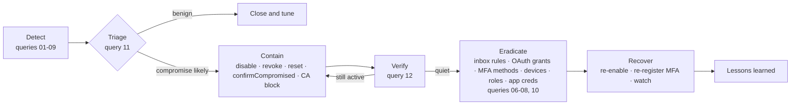

# Entra ID Account Compromise: Incident Response Runbook and Detections

An incident response runbook for a compromised Microsoft Entra ID user
account. It ships with KQL detection and triage queries for Microsoft Sentinel
and Log Analytics, a flow diagram, and a tabletop exercise. Each step maps to
the NIST SP 800-61 phases and MITRE ATT&CK technique IDs.

> **Status: draft. The queries are untested.** None of the queries has been
> run against a Log Analytics workspace, a Sentinel instance or any tenant, so
> there are **no detection results, false-positive rates or timings** in this
> repo. The runbook has not been exercised either. What *has* been checked is
> listed under [What has been validated](#what-has-been-validated). Treat
> everything else as a starting point that you test in your own lab first.

---

## Problem

Most cloud identity incidents start with one user account: a phished
password, an approved MFA prompt the user didn't start, a stolen session
token, or an OAuth app the user consented to. The first hour decides how bad
it gets. Responders who have to work out from scratch which logs to query,
what order to contain in, and which persistence to look for lose that hour.
Common mistakes:

- Revoking sessions while the attacker still knows the password
- Resetting the password while an attacker-registered MFA method or OAuth
  grant keeps access open
- Missing the inbox rule that hides the fraud emails

## Approach

| Piece | What it gives you |
|---|---|
| [`docs/runbook.md`](docs/runbook.md) | Steps for Prepare, Detect, Triage, Contain, Eradicate, Recover and Lessons learned. Each step lists the exact Graph or PowerShell call, the permission or least-privileged role, the ATT&CK technique and the Microsoft Learn source |
| [`queries/`](queries) | 12 KQL queries: 10 for detection and scoping, 1 for the triage timeline, and 1 for containment verification. Each file header lists its tables, fields, assumptions, licensing needs and sources |
| [`docs/tabletop-fabrikam.md`](docs/tabletop-fabrikam.md) | A 90-minute tabletop exercise built around a fictional MFA fatigue → inbox rule → consent phishing chain at Fabrikam |
| [`SOURCES.md`](SOURCES.md) | Every table, field, activity name, API and technique ID used, with the page it came from |
| [`tools/kqlcheck`](tools/kqlcheck) | An offline parser/binder check for the queries against the documented table schemas |

### Response flow



There's a more detailed diagram in the runbook.

### Query index

| # | Query | Tables | ATT&CK |
|---|---|---|---|
| 01 | Impossible / atypical travel risk detections | AADUserRiskEvents | T1078.004 |
| 02 | Travel-velocity heuristic (no P2 needed) | SigninLogs | T1078.004 |
| 03 | MFA fatigue: denial bursts, plus success after denial | SigninLogs | T1621, T1078.004 |
| 04 | User-reported suspicious MFA prompts | AADUserRiskEvents, AuditLogs | T1621 |
| 05 | Medium/high-risk sign-ins | SigninLogs | T1078.004 |
| 06 | Forwarding / hiding inbox rules | OfficeActivity | T1114.003, T1564.008 |
| 07 | OAuth consent and permission grants | AuditLogs | T1528, T1566.002, T1550.001 |
| 08 | MFA method / device registered after a risk detection | AADUserRiskEvents, AuditLogs | T1556.006, T1098.005 |
| 09 | Device code flow sign-ins | SigninLogs, AADNonInteractiveUserSignInLogs | T1566.002, T1078.004 |
| 10 | Persistence and privilege changes | AuditLogs | T1098.001, T1098.003, T1098.005, T1556.006 |
| 11 | Triage: one user's sign-in timeline by IP | SigninLogs, AADNonInteractiveUserSignInLogs | T1078.004, T1539, T1550.001 |
| 12 | Containment verification | AuditLogs, SigninLogs, AADNonInteractiveUserSignInLogs | — |

## How to use

1. **Before an incident**, work through runbook section 0. Connect the
   Sentinel Microsoft Entra ID connector (sign-in, non-interactive sign-in,
   audit and risk logs) and the Microsoft 365 connector (`OfficeActivity`).
2. **Run each query in a lab workspace first.** Paste it into Log Analytics or
   Sentinel > Logs, check that it returns what you expect, and tune the
   `let` thresholds at the top. Values such as `denial_threshold`, `window`,
   `min_km` and `max_kmh` are starting assumptions, not measured values.
3. **Promote the ones that work** to Sentinel analytics rules or hunting
   queries, following your own change process.
4. **During an incident**, follow `docs/runbook.md` top to bottom. Use queries
   `10`, `11` and `12` with `target_upn` / `suspect_upns` / `contained_at` set.
5. **Run the tabletop** with your team. Feed the gaps back into the runbook.

To re-run the offline static check (requires the .NET 8 SDK):

```bash
cd tools/kqlcheck
dotnet run -- ../..
```

## Scope and limitations

- **Untested queries.** See the status note at the top. The static check
  proves the queries parse and only reference documented tables and columns.
  It doesn't prove that the string values (activity names, risk types,
  parameter names) or the JSON paths inside `dynamic` columns match what your
  tenant actually logs.
- **Licensing:**
  - Sign-in log ingestion needs Entra ID P1 or P2.
  - Most risk detail (`AADUserRiskEvents`, risk levels, `confirmCompromised`)
    needs Entra ID P2. Free and P1 tenants see `generic` or `hidden`.
  - `mcasImpossibleTravel` also needs Microsoft Defender for Cloud Apps.
  - Query `06` needs the Microsoft 365 / Exchange audit data in Sentinel.
- **Naming differences in Microsoft's docs:**
  - The ID Protection risk page names the travel detections `unlikelyTravel`
    and `mcasImpossibleTravel`. The Graph `riskDetection` enum also lists
    `impossibleTravel`. Query `01` matches all three.
  - The `500121` description is from the Entra error lookup page; it isn't on
    the AADSTS reference page.
- **Column types differ between tables.** `LocationDetails`, `DeviceDetail`
  and `Status` are `dynamic` in `SigninLogs` but `string` in
  `AADNonInteractiveUserSignInLogs`. The union queries project only scalar
  columns for that reason.
- **Retention.** Entra keeps audit logs for 30 days unless they are exported,
  and Purview Audit (Standard) keeps them for 180 days. Investigations older
  than that depend on what you exported.
- **Out of scope:** on-premises AD compromise, endpoint forensics,
  tenant-wide Global Administrator compromise, and legal or regulatory
  notification decisions.
- **NIST mapping.** The mapping uses the SP 800-61 Rev. 2 phases, which are
  still widely used. Rev. 3 (April 2025) supersedes Rev. 2 and maps those
  phases to the CSF 2.0 Functions (its Table 1). The runbook shows both.
- **ATT&CK tactic names change between ATT&CK releases.** This repo records
  technique IDs only. Check tactic names on attack.mitre.org.

## What has been validated

As of 2026-11-01, only the following was done:

| Check | Result |
|---|---|
| Every table, column, activity name, API, permission and ATT&CK ID in this repo checked against the source page listed in [`SOURCES.md`](SOURCES.md) | Done, by reading each page on 2026-11-01 |
| All 12 queries parsed and bound by [`tools/kqlcheck`](tools/kqlcheck) (Microsoft `Kusto.Language` 12.4.1) against schemas taken from the Azure Monitor table reference pages | 12/12 passed with no errors. A deliberate bad-column, bad-syntax and bad-table test each failed as expected, which shows that the check does catch those cases |
| Queries run against real or sample data | **Not done** |
| Runbook steps run in a tenant | **Not done** |
| Tabletop run with a team | **Not done** |
| `gitleaks` 8.30.1 secret scan (`gitleaks dir` before commit, `gitleaks detect` on the commit) | No leaks found |

## Related

- [`azure-entra-identity-hardening`](https://github.com/mikedsosa/azure-entra-identity-hardening) is a companion project. It holds the
  Terraform baseline for Conditional Access, break-glass and PIM that
  prevents or limits many of the attack paths here. Its short runbooks are
  the starting point this repo expands on.

## License

MIT. See [LICENSE](LICENSE).
