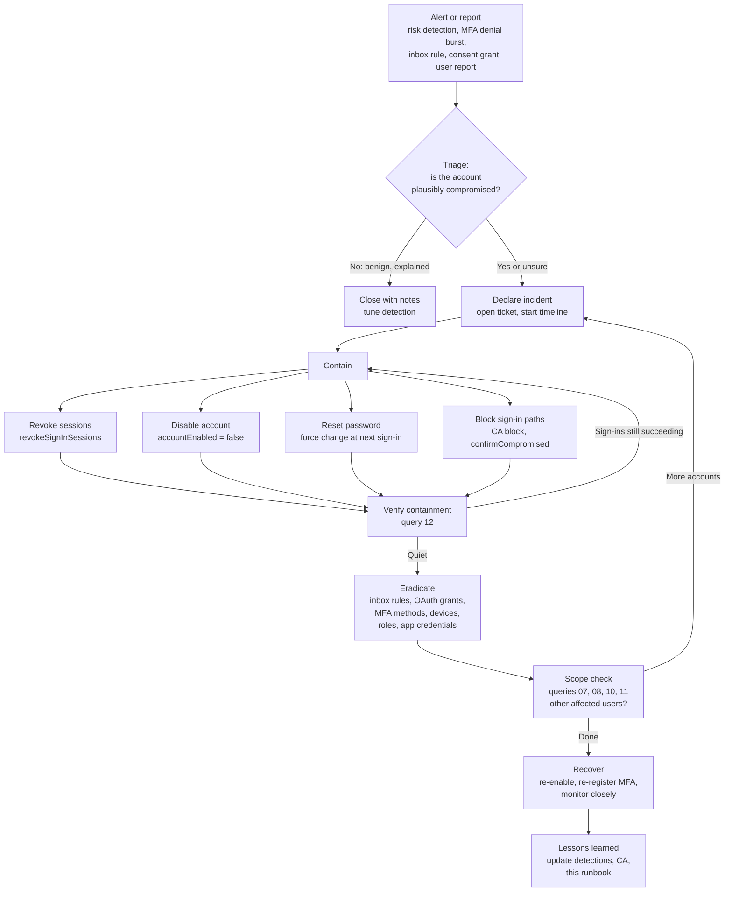

# Runbook: Microsoft Entra ID account compromise

> **Status: draft, not exercised.** The steps below have not been run in a
> live incident or a lab tenant. Every command and API comes from the Microsoft
> Learn page linked next to it (checked 2026-11-01). Check current
> documentation, licensing and your own change process before you use any of
> it.

**Scope:** one or more Entra ID user accounts that are suspected or confirmed
compromised (stolen password, phished session or token, MFA fatigue, or
illicit OAuth consent). Exchange Online mailbox abuse that follows such a
compromise is also in scope. Not in scope: on-premises AD forest compromise,
endpoint malware response, and tenant-wide compromise of a Global
Administrator. Those need their own playbooks. This runbook can feed them.

## How the phases map

The phases follow NIST SP 800-61 Rev. 2. Rev. 3 (April 2025) supersedes Rev. 2
and uses the NIST CSF 2.0 Functions instead. Table 1 of Rev. 3 maps the old
phases to the new Functions, so both are shown.

| This runbook | SP 800-61r2 phase | CSF 2.0 Function (per SP 800-61r3 Table 1) |
|---|---|---|
| 0. Prepare | Preparation | Govern, Identify, Protect |
| 1. Detect | Detection & Analysis | Detect |
| 2. Triage | Detection & Analysis | Detect, Identify (Improvement) |
| 3. Contain | Containment, Eradication & Recovery | Respond |
| 4. Eradicate | Containment, Eradication & Recovery | Respond |
| 5. Recover | Containment, Eradication & Recovery | Recover |
| 6. Lessons learned | Post-Incident Activity | Identify (Improvement) |

## Flow



## 0. Prepare (before any incident)

| Item | Why | Source |
|---|---|---|
| Send `SigninLogs`, `AADNonInteractiveUserSignInLogs`, `AuditLogs`, `AADUserRiskEvents`, `AADRiskyUsers` to Sentinel / Log Analytics | Entra keeps audit logs for 30 days unless they are exported. Sign-in log ingestion needs Entra ID P1 or P2 | [Sentinel Entra ID connector](https://learn.microsoft.com/en-us/azure/sentinel/connect-azure-active-directory), [Security operations: user accounts](https://learn.microsoft.com/en-us/entra/architecture/security-operations-user-accounts) |
| Connect Microsoft 365 / Exchange audit (`OfficeActivity`) | Needed for inbox-rule and mailbox evidence | [OfficeActivity table](https://learn.microsoft.com/en-us/azure/azure-monitor/reference/tables/officeactivity), [Purview audit activities](https://learn.microsoft.com/en-us/purview/audit-log-activities) |
| Turn on "Report suspicious activity" for MFA | A user report raises the user to high risk and gives you a signal (query 04) | [MFA settings](https://learn.microsoft.com/en-us/entra/identity/authentication/howto-mfa-mfasettings) |
| Pre-approve the responder roles and Graph permissions in the tables below | Avoids waiting on access in the middle of an incident | Graph pages cited per step |
| Keep break-glass accounts excluded from blocking CA policies | Avoids locking yourself out while containing | [Block access by location](https://learn.microsoft.com/en-us/entra/identity/conditional-access/policy-block-by-location) |

## 1. Detect

Start from any of these signals. Each one has a query in [`../queries`](../queries).

| Signal | Query | ATT&CK |
|---|---|---|
| Atypical / impossible travel risk detection | `01`, `02` | [T1078.004](https://attack.mitre.org/techniques/T1078/004/) |
| Burst of MFA denials (`ResultType` 500121), success after denials | `03` | [T1621](https://attack.mitre.org/techniques/T1621/) |
| User reported an MFA prompt they didn't start | `04` | [T1621](https://attack.mitre.org/techniques/T1621/) |
| Medium/high-risk sign-in that succeeded | `05` | [T1078.004](https://attack.mitre.org/techniques/T1078/004/) |
| New inbox rule that forwards, deletes or hides mail | `06` | [T1114.003](https://attack.mitre.org/techniques/T1114/003/), [T1564.008](https://attack.mitre.org/techniques/T1564/008/) |
| OAuth consent / delegated permission grant | `07` | [T1528](https://attack.mitre.org/techniques/T1528/), [T1566.002](https://attack.mitre.org/techniques/T1566/002/) |
| MFA method or device registered right after a risk detection | `08` | [T1556.006](https://attack.mitre.org/techniques/T1556/006/), [T1098.005](https://attack.mitre.org/techniques/T1098/005/) |
| Device code flow sign-in | `09` | [T1566.002](https://attack.mitre.org/techniques/T1566/002/) |
| Password spray risk detection (`passwordSpray`) or many `50126` failures | `01` (change the RiskEventType list) | [T1110.003](https://attack.mitre.org/techniques/T1110/003/) |
| Adversary-in-the-middle / token anomaly detections (`attackerinTheMiddle`, `anomalousToken`) | `01` (change the RiskEventType list) | [T1557](https://attack.mitre.org/techniques/T1557/), [T1539](https://attack.mitre.org/techniques/T1539/) |

Risk detection names come from
[What are risk detections?](https://learn.microsoft.com/en-us/entra/id-protection/concept-identity-protection-risks).
Free and P1 tenants see most of them only as `generic`.

## 2. Triage

Goal: decide quickly whether this is a real compromise, then scope it. If you
can't rule out compromise within your agreed time, treat it as real and
contain. Containment can be reversed. Data loss can't.

1. **Open a ticket and a timeline.** Record every action with time (UTC), who
   did it and why.
2. **Pull the sign-in timeline** for the user (query `11`). Look for:
   - new IPs, ASNs or locations
   - new user agents
   - successful non-interactive sign-ins from IPs the user never signed in from
     interactively (possible token replay: [T1550.001](https://attack.mitre.org/techniques/T1550/001/), [T1539](https://attack.mitre.org/techniques/T1539/))
3. **Check how the user authenticated.** In `SigninLogs`, look at
   `AuthenticationRequirement`, `AuthenticationDetails`,
   `ConditionalAccessStatus` and `ClientAppUsed`. Legacy clients (Other
   clients, POP, IMAP, MAPI, SMTP, ActiveSync) bypass MFA. They are flagged in
   [Security operations: user accounts](https://learn.microsoft.com/en-us/entra/architecture/security-operations-user-accounts).
4. **Ask the user** (out of band, not by email to the possibly compromised
   mailbox): did you travel, approve a prompt or enter a code?
5. **Check for persistence already in place:** queries `06`, `07`, `08`, `10`.
6. **List the user's authentication methods**
   ([list methods](https://learn.microsoft.com/en-us/graph/api/authentication-list-methods?view=graph-rest-1.0)):
   ```powershell
   Get-MgUserAuthenticationMethod -UserId <user-id>
   ```
   (Graph permission: `UserAuthenticationMethod.Read.All`.)
7. **Decide:** benign (close and tune), suspicious (contain) or confirmed
   (contain and escalate). If the user holds admin roles, escalate at once.

## 3. Contain

Do these steps **in this order**, as close together as you can. Revoking
sessions alone isn't enough while the attacker still knows the password. A
password reset alone doesn't end sessions that already exist.

| # | Action | How | Permission / least role | Source |
|---|---|---|---|---|
| 3.1 | **Disable the account** (blocks sign-in) | `Update-MgUser -UserId <id> -AccountEnabled:$false`, or `PATCH /users/{id}` with `{"accountEnabled": false}` | `User.EnableDisableAccount.All` + `User.Read.All`. User Administrator for non-admins, Privileged Authentication Administrator for admins | [Update user](https://learn.microsoft.com/en-us/graph/api/user-update?view=graph-rest-1.0), [Revoke user access](https://learn.microsoft.com/en-us/entra/identity/users/users-revoke-access) |
| 3.2 | **Revoke sessions / refresh tokens** | `Revoke-MgUserSignInSession -UserId <id>`, or `POST /users/{id}/revokeSignInSessions` | `User.RevokeSessions.All` | [revokeSignInSessions](https://learn.microsoft.com/en-us/graph/api/user-revokesigninsessions?view=graph-rest-1.0) |
| 3.3 | **Reset the password** and force a change at next sign-in | `PATCH /users/{id}` with `passwordProfile` and `forceChangePasswordNextSignIn: true`. For hybrid accounts, reset in on-premises AD (twice, per Learn) and disable there with `Disable-ADAccount` | `User-PasswordProfile.ReadWrite.All` (cloud-only accounts; not usable for federated users) | [Update user](https://learn.microsoft.com/en-us/graph/api/user-update?view=graph-rest-1.0), [Revoke user access](https://learn.microsoft.com/en-us/entra/identity/users/users-revoke-access) |
| 3.4 | **Mark the user compromised** (ID Protection P2) so user-risk policies apply | `Confirm-MgRiskyUserCompromised -UserIds <id>`, or `POST /identityProtection/riskyUsers/confirmCompromised` | `IdentityRiskyUser.ReadWrite.All`. Security Administrator | [confirmCompromised](https://learn.microsoft.com/en-us/graph/api/riskyuser-confirmcompromised?view=graph-rest-1.0) |
| 3.5 | **Block attacker infrastructure** if it's a clear set of IPs or countries: a Conditional Access policy with Grant > Block, scoped to a named location, excluding break-glass accounts | Entra admin center > Conditional Access. CA applies after first-factor authentication | Conditional Access Administrator | [Block access by location](https://learn.microsoft.com/en-us/entra/identity/conditional-access/policy-block-by-location) |
| 3.6 | **Disable the user's devices** if a device may be attacker-registered or compromised | Entra admin center > Devices (the Learn page covers disabling devices; check it for the current role) | See Learn | [Revoke user access](https://learn.microsoft.com/en-us/entra/identity/users/users-revoke-access) |

**Timing caveats (from Learn):** revocation can take a few minutes to apply.
Access tokens already issued stay valid until they expire (about one hour)
unless the app supports Continuous Access Evaluation. That's why you disable
the account and reset the password as well as revoking sessions.

**Verify:** run query `12` with `contained_at` set. Expect the containment
activities to appear in `AuditLogs` (`Disable account`,
`Update StsRefreshTokenValidFrom Timestamp`, `Reset password (by admin)`) and
no successful sign-ins after that time. If sign-ins still succeed, go back to 3.

ATT&CK techniques this step disrupts: [T1078.004](https://attack.mitre.org/techniques/T1078/004/), [T1539](https://attack.mitre.org/techniques/T1539/), [T1550.001](https://attack.mitre.org/techniques/T1550/001/).

## 4. Eradicate

Remove everything the attacker added. Scope it with queries `06`, `07`, `08`
and `10` over the whole suspected compromise window, not just the day of the
alert.

| # | Remove | How | ATT&CK | Source |
|---|---|---|---|---|
| 4.1 | Malicious inbox rules (forward, redirect, delete, hide) | `Get-InboxRule -Mailbox <upn>` to review, then `Remove-InboxRule`. Learn notes that Exchange PowerShell rule changes also remove client-side rules that Outlook disabled. Export the rules as evidence first | [T1114.003](https://attack.mitre.org/techniques/T1114/003/), [T1564.008](https://attack.mitre.org/techniques/T1564/008/) | [Remove-InboxRule](https://learn.microsoft.com/en-us/powershell/module/exchangepowershell/remove-inboxrule?view=exchange-ps) |
| 4.2 | Illicit OAuth consent | Delete the delegated grant: `Remove-MgOauth2PermissionGrant -OAuth2PermissionGrantId <id>` (`DELETE /oAuth2PermissionGrants/{id}`, `DelegatedPermissionGrant.ReadWrite.All`). The app consent playbook advises **disabling** the malicious app (service principal) rather than deleting it, so evidence is kept. Access tokens already issued stay valid until they expire | [T1528](https://attack.mitre.org/techniques/T1528/), [T1550.001](https://attack.mitre.org/techniques/T1550/001/) | [Delete oAuth2PermissionGrant](https://learn.microsoft.com/en-us/graph/api/oauth2permissiongrant-delete?view=graph-rest-1.0), [App consent IR playbook](https://learn.microsoft.com/en-us/security/operations/incident-response-playbook-app-consent) |
| 4.3 | Attacker-registered MFA methods | Compare the method list from triage step 6 with what the user confirms is theirs. Delete unknown methods (Entra admin center > user > Authentication methods). Look for `User registered security info` and `Admin registered security info` in the window | [T1556.006](https://attack.mitre.org/techniques/T1556/006/) | [List methods](https://learn.microsoft.com/en-us/graph/api/authentication-list-methods?view=graph-rest-1.0), [Audit activities](https://learn.microsoft.com/en-us/entra/identity/monitoring-health/reference-audit-activities) |
| 4.4 | Attacker-registered or joined devices | Review `Register device` / `Add device` events (query `08`, `10`), then disable or delete the device | [T1098.005](https://attack.mitre.org/techniques/T1098/005/) | [Audit activities](https://learn.microsoft.com/en-us/entra/identity/monitoring-health/reference-audit-activities) |
| 4.5 | Role assignments the attacker added | Review `Add member to role` / `Add eligible member to role` (query `10`) and remove anything unapproved | [T1098.003](https://attack.mitre.org/techniques/T1098/003/) | [Audit activities](https://learn.microsoft.com/en-us/entra/identity/monitoring-health/reference-audit-activities) |
| 4.6 | App / service principal credentials or owners the attacker added | Review `Add service principal credentials`, `Update application - Certificates and secrets management` and `Add owner to application` (query `10`). Remove the credentials and rotate any secrets that may have been exposed | [T1098.001](https://attack.mitre.org/techniques/T1098/001/) | [Audit activities](https://learn.microsoft.com/en-us/entra/identity/monitoring-health/reference-audit-activities) |
| 4.7 | Tenant-level changes (CA policies, named locations, federation or domain settings) | Review the matching `AuditLogs` activities (query `10`) and roll back. A change to federation settings means you **escalate**: treat it as a tenant-wide incident | [T1556.006](https://attack.mitre.org/techniques/T1556/006/) | [Audit activities](https://learn.microsoft.com/en-us/entra/identity/monitoring-health/reference-audit-activities) |
| 4.8 | Other accounts hit by the same campaign | Search for the attacker IPs, app IDs and inbox rule patterns across all users. Each new account goes back to step 3 | — | — |

## 5. Recover

1. Confirm eradication is complete (re-run queries `06`, `07`, `08`, `10` for
   the user; expect no new hits).
2. Re-enable the account (`accountEnabled: true`) only after the user has
   confirmed their identity through an out-of-band channel.
3. Have the user re-register MFA, using phishing-resistant methods where
   available. Remove any temporary access you issued.
4. If you used `confirmCompromised`, remediate or dismiss the user risk in ID
   Protection once the account is clean. That way policies don't keep blocking
   the user.
5. Restore mail that rules moved or deleted, if retention allows. Tell the
   people the mailbox emailed during the compromise window if phishing or
   fraud was sent from it.
6. Watch more closely for an agreed period (for example, run queries `05`,
   `06` and `11` daily for the user). How long is a local decision; this
   runbook does not prescribe it.

## 6. Lessons learned

Hold a blameless review within an agreed number of days after closure. At
minimum, record:

- **Timeline:** first malicious activity, detection, containment and recovery,
  all in UTC, taken from logs rather than memory.
- **Initial access:** how the attacker got in, mapped to ATT&CK.
- **Detection:** which signal fired, which should have fired and didn't, and
  why.
- **Control gaps:** for example legacy auth allowed, no device-code block, user
  consent allowed for unverified publishers, or MFA without number matching or
  phishing resistance.
- **Runbook changes:** which steps were slow, unclear or missing.
- **Detection changes:** new or tuned queries, with the thresholds you
  changed and why.

Track each action item to an owner and a date. The companion
[`azure-entra-identity-hardening`](https://github.com/mikedsosa/azure-entra-identity-hardening) project (a separate repo) holds the Conditional Access baselines that most of these
fixes would land in.
